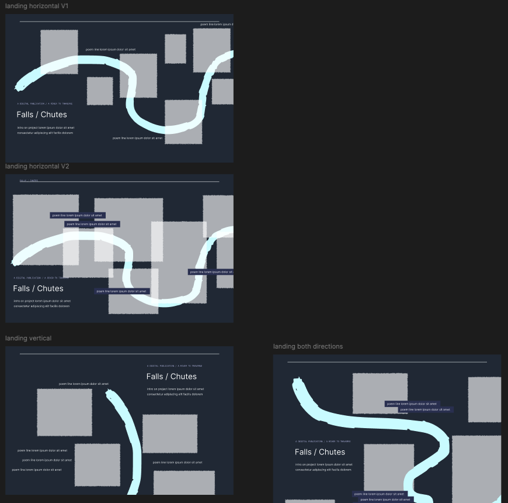
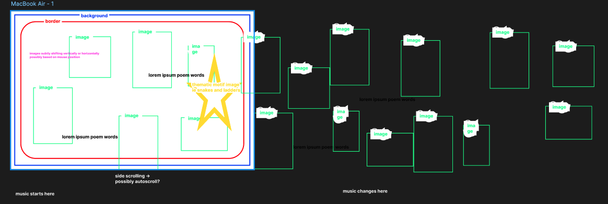
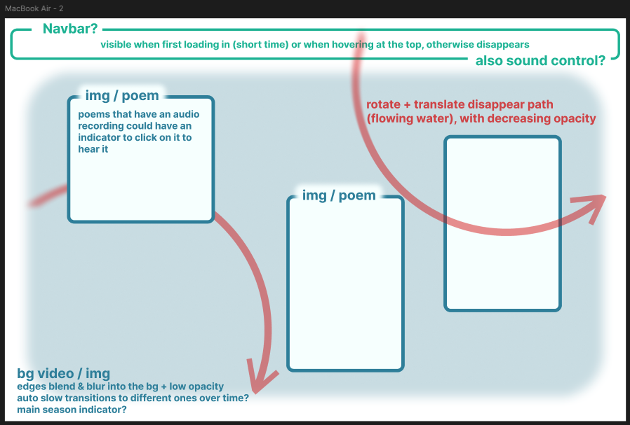
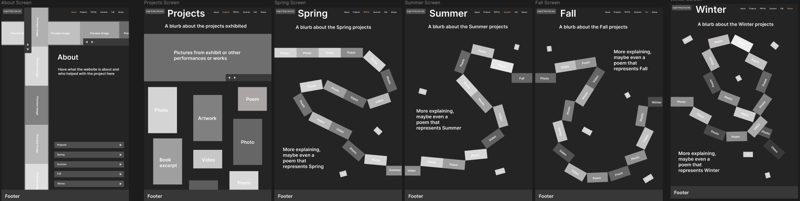

## Week 4

During class, we had another meeting with VK. We went to the visualization studio in the library and they further explained their project so we can have a clearer idea of their vision and the project as a whole. We also met Valentina Plata who is the composer who leads the project for Winter at the moment. The meeting allowed us to ask a lot of questions and clarify certain elements. VK still does not have a concrete vision for the web experience so we proposed to them that we would create a few concept wireframes for the layout and present them at our next meeting the following week with them.

__Meeting notes:__
- Concept: spiral (18 months in hostpital)
- 2 loops = hospital and waterfall
- two sides of same river , you walk out of the care home and walk this river , rivers and care constant -  moving in and out of care home
- Keep the spine but not linear
- Adaptable and open for other seasons
- Password protection for work in progress things / sections ?
- Integrate the raw sound (we have a lot)
- Interactive, tactile sounds ,
- What happens when VK speaks == idea ! Distortion visually on the website when we hear the poetry (either auto playing or  based on smt the user does without realizing or dmt the user does on purpose)
- Binoral version and 26.1 version of audio
- Snakes and ladders and healthcare system - linear progress and then something happens, you get a phone call and you’re back wards
- Pathways - traversing a route over and over but it’s also changing over time and seasons
- Euclydian motion of the water
- Everytime you interact it’s new ?
- Loops are poem length (written and audio integrated) (average 2-3 minutes per loop) (average 6 poems per season (ish))
- Spiral that loops and goes back  (fall winter spring summer fall winter())
- Possibility of them going back and bridge the seasons
- When you go on a trail heads and there are different loops of different lengths and paths you can choose = poem as a walk on the river with the destination as the waterfall
- Bjork’s website - open up to something map like , web  experience, inspoooo = idea of having a map and being able to enter into it and it being moving already https://www.bjork.com/ 

We decided to each create a rough layout wireframe. It was not absolutely necessary but it would allow us all to take our time, reflect, and be creative and each create something unique and different. It allowed us to cast a wider net and experiment with different unique ideas. We had a little call on Monday to show each other our wireframes and discuss as a team. I am so happy we did that because all 4 wireframes are super interesting and creative in different ways. I don't think we would of had this much variety and creativity if we did it together and made less of them. All 4 bring something unique to the table so we will present them all. After our call Monday, we worked individually again on our own wireframe to simply refine them and add basic animations. 

We have another meeting with VK next class and we will show them the concepts and try our absolute best to have them commit a concept / a hybrid of concepts. The teamwork and communication is going great with the team. We create a discord server (previously we only had a groupchat) which allows us to communicate in a more organized way and we have organized it so that we can share ressources and links without them getting lost in the chat.