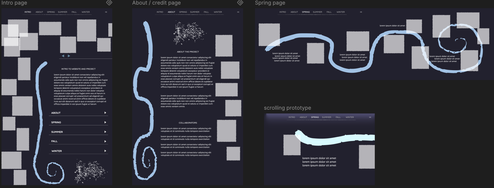
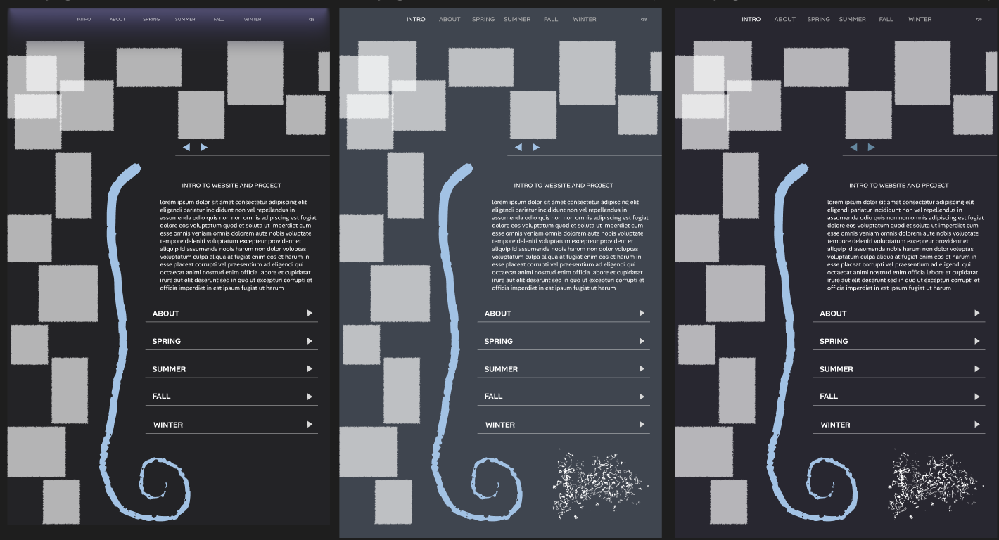
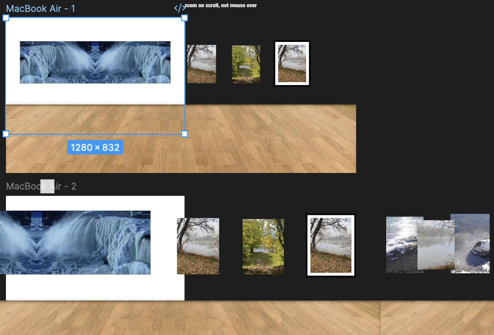
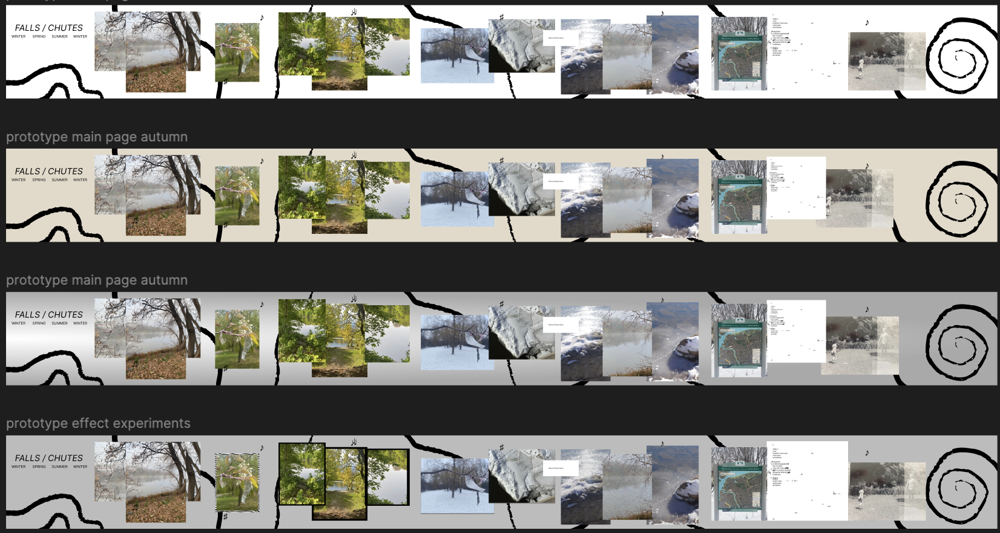
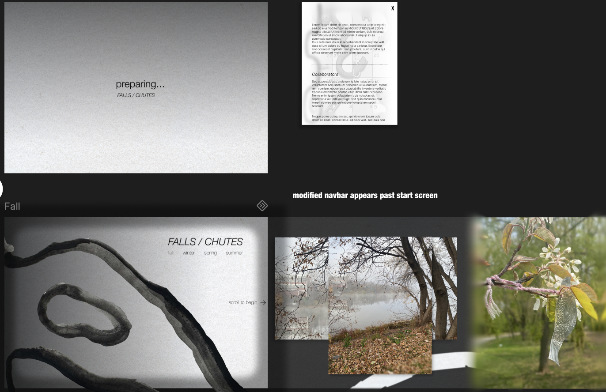
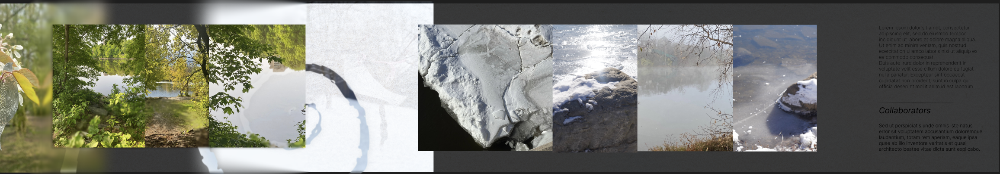

## Week 5

Last week we met with VK Preston and proposed different directions this website could go in. VK told us which elements they liked from those prototypes. They really liked the flow and spiral element from mine and the navigation menus from Tatiana's and Marge's prototypes. We got plenty of positive feedback from that meeting with them and they said that we should trust our creative vision and our current direction.

We took this feedback and create a new prototype, hoping we could soon start coding the actual website once we establish a clear vision. We created this new hybrid prototype using everything VK said they liked from our first set of prototypes. We also tried different colour schemes, the very light ones were harsh and not visually pleasing to the eyes and VK had not said they disliked our darker approach before so we proposed 3 different colour schemes that leaned darker with good contrast.

We had a call with VK, Cassey, and Val during reading week to show them this first hybrid prototype and show them where we were at, hoping we could narrow down the vision a lot more since midterm presentations are coming up very soon. It was quite a discouraging call. Even though we stayed loyal to what they really liked from the previous prototypes, they did not have many positive words for this hybrid prototype. They want it to be white, which is an easy fix. That was not really the issue, they just did not like anything we really showed them. They kind of liked the navigation bar but that was it. 

It felt so disheartening not because of the feedback itself. But because they have not expressed any clear vision or direction for this project in the last weeks we have been meeting with them and this is such a personal project so it feels impossible to do it justice when we are not really connected to the topic in the same way VK is. It is also because we took the exact elements they liked from the previous week's meeting and it just feels like such a sudden switch up. It also feels like we are trying to make a website that is for the public to learn about this very meaningful project in an accessible way but their very narrow and limited vision feels more like something just for them to interact with, without taking into account a stranger interacting with the website. 

We regrouped and talked to Sabine. Once moral was back up, we switched gears completely and created an entirely new round of fresh prototypes to hopefully capture what VK is failing to explain. This is what we were able to come up with before next class.

These feel completely fresh and new, we are hoping that VK likes one of these and gives us real concrete feedback so that we can actually start coding :D (if it feels like I am repeating myself, it is because I am). 

The team is doing well, we are communicating well and adapting to each other's shedules. Everyone is supporting one another when unexpecting things come up or when someone is busy. Moral definetly went down after that last call but the fact that we are all in this together with Sabine being so understanding and supportive (thank youuuu), it is all good. 
